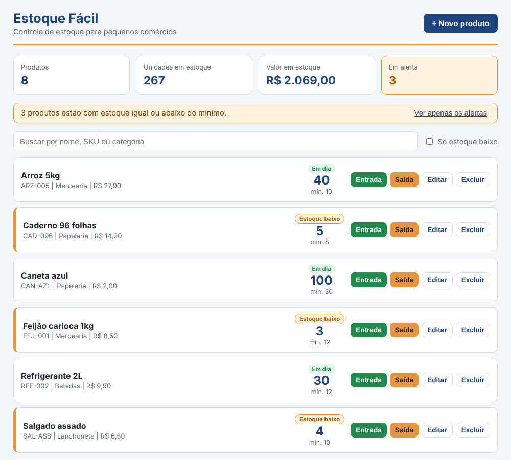
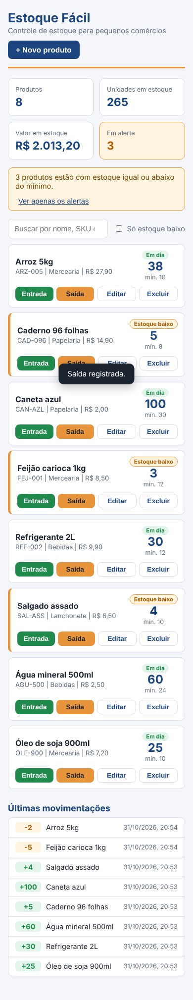

# Estoque Fácil

Prova de Conceito (PoC) de um **sistema de gestão de estoque para pequenos comércios** (mercadinhos, papelarias,
lanchonetes). Projeto Integrador, 2ª etapa, Senac EAD (TADS / TSI), disciplina de Desenvolvimento de Sistemas
Orientado a Dispositivos Móveis e Baseados na Web.

## Jornada implementada

> O comerciante cadastra um produto, registra entradas e saídas de estoque, e o sistema mostra o estoque atual
> com **alerta de estoque baixo**.

A justificativa da escolha da PoC está em [`docs/definicao-poc.md`](docs/definicao-poc.md).

## Telas





## Funcionalidades

- Cadastro, edição e exclusão de produtos (nome, SKU, categoria, preço, estoque mínimo e inicial)
- Registro de **entrada** e **saída** de estoque, com observação opcional
- Bloqueio de saída maior que o saldo (o estoque nunca fica negativo)
- **Alerta de estoque baixo** quando o saldo é menor ou igual ao mínimo, com filtro "Só estoque baixo"
- Painel de resumo (produtos, unidades, valor em estoque, produtos em alerta)
- Histórico das últimas movimentações
- Interface responsiva (funciona no celular)

## Tecnologias

| Camada | Tecnologia |
|---|---|
| Frontend | React 19, Vite |
| Backend | Node.js, Express |
| Banco de dados | SQLite (módulo `node:sqlite`, embutido no Node 22) |
| Testes | `node:test` (API) |

## Estrutura de pastas

```
projeto-integrador-estoque-facil/
├── backend/            API REST (Express + SQLite)
│   ├── src/
│   │   ├── app.js      rotas e regras de negócio
│   │   ├── db.js       conexão e criação das tabelas
│   │   ├── seed.js     dados de exemplo
│   │   └── server.js   inicialização do servidor
│   └── test/           testes automatizados da API
├── frontend/           interface web (React + Vite)
│   └── src/
│       ├── App.jsx
│       ├── api.js
│       ├── components/
│       └── styles.css
├── docs/
│   └── definicao-poc.md
└── README.md
```

## Pré-requisitos

- [Node.js](https://nodejs.org/) **22.13 ou superior** (confira com `node -v`). O projeto usa o SQLite que já vem
  dentro do Node 22, então **não precisa instalar banco de dados nem compilador**.
- npm (já vem com o Node.js)
- Git (para clonar o repositório)

> Quem usa o **nvm** (Windows ou Linux/macOS) pode trocar de versão com `nvm install 22` e `nvm use 22`.
> Ao iniciar o backend aparece o aviso `ExperimentalWarning: SQLite is an experimental feature`. É normal e não
> afeta o funcionamento.

## Como executar

Abra **dois terminais**. Os comandos funcionam em Windows (PowerShell), macOS e Linux.

**1. Clonar e instalar as dependências (só na primeira vez)**

```bash
git clone https://github.com/thomazvictorr/projeto-integrador-estoque-facil.git
cd projeto-integrador-estoque-facil

cd backend
npm install
cd ../frontend
npm install
cd ..
```

**2. (Opcional) Carregar dados de exemplo**

```bash
cd backend
npm run seed
```

**3. Terminal 1: subir o backend (porta 3001)**

```bash
cd backend
npm start
```

Teste rápido: abra <http://localhost:3001/api/health>. Deve responder `{"status":"ok"}`.

**4. Terminal 2: subir o frontend (porta 5173)**

```bash
cd frontend
npm run dev
```

**5. Acessar a aplicação**

Abra <http://localhost:5173> no navegador. Os dois terminais precisam continuar abertos (`Ctrl + C` para parar).

> Se a porta 3001 estiver ocupada, use outra. Linux/macOS: `PORT=3002 npm start` e, no frontend,
> `VITE_API_URL=http://localhost:3002 npm run dev`. PowerShell: `$env:PORT=3002; npm start` e
> `$env:VITE_API_URL="http://localhost:3002"; npm run dev`.

Para zerar os dados, pare o backend, apague a pasta `backend/data` e rode o seed de novo.

## Executar os testes

```bash
cd backend
npm test
```

Os testes cobrem a jornada completa (cadastro, entrada, saída e alerta), o bloqueio de saída maior que o
estoque, as validações e a edição e exclusão de produtos.

## API REST

Base: `http://localhost:3001/api`

| Método | Rota | Descrição |
|---|---|---|
| GET | `/health` | Verifica se a API está no ar |
| GET | `/resumo` | Totais do painel |
| GET | `/produtos?busca=&baixo=1` | Lista produtos (filtro por texto e por estoque baixo) |
| GET | `/produtos/:id` | Detalhe de um produto |
| POST | `/produtos` | Cadastra produto |
| PUT | `/produtos/:id` | Edita produto (o saldo só muda por movimentação) |
| DELETE | `/produtos/:id` | Exclui produto e seu histórico |
| POST | `/produtos/:id/movimentacoes` | Registra `ENTRADA` ou `SAIDA` |
| GET | `/movimentacoes?limite=&produto_id=` | Histórico de movimentações |

Exemplo:

```bash
curl -X POST http://localhost:3001/api/produtos/1/movimentacoes \
  -H "Content-Type: application/json" \
  -d '{"tipo":"SAIDA","quantidade":3,"observacao":"Venda no balcão"}'
```

Códigos de erro: `400` dados inválidos, `404` não encontrado, `409` SKU duplicado, `422` estoque insuficiente.

## Modelagem de dados

```
produtos (id, nome, sku UNIQUE, categoria, preco, estoque_atual, estoque_minimo, criado_em)
movimentacoes (id, produto_id FK, tipo ENTRADA|SAIDA, quantidade, observacao, criado_em)
```

Relação 1:N entre `produtos` e `movimentacoes`. Detalhes e diagrama em `docs/definicao-poc.md`.

## Equipe

| Integrante |
|---|
| Diogo Ruan Elias |
| Henrique Bezerra Amaral |
| Lucas Pinto Bezerra |
| Thomaz Victor de Oliveira |

Todos os integrantes devem ser adicionados como colaboradores do repositório e fazer commits próprios.

## Vídeo de demonstração

Link do vídeo (máx. 1 minuto): _preencher com o link privado do YouTube ou o caminho do MP4 no repositório_.

## Próximas etapas (fora do escopo da PoC)

Login e perfis de usuário, fornecedores, relatórios, leitura de código de barras, integração com PDV.
